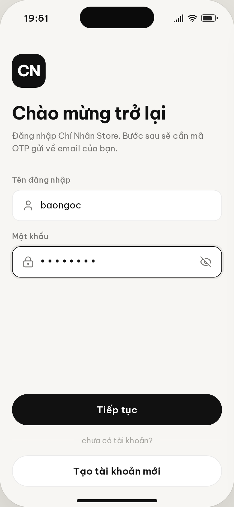
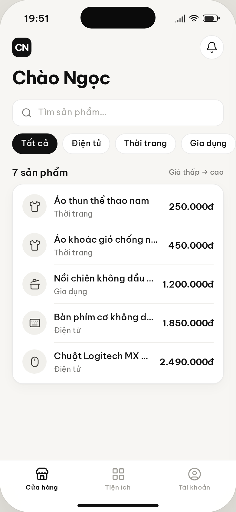
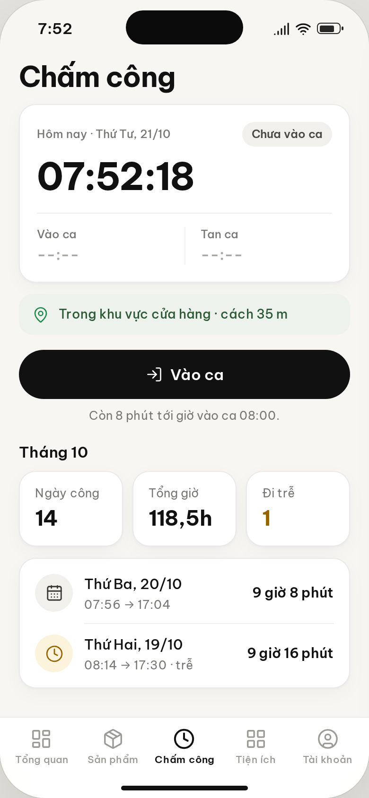
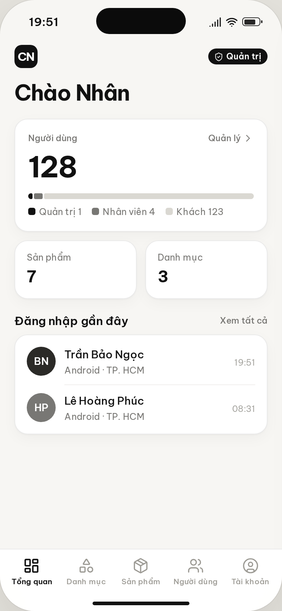

<div align="center">

# Nguyễn Chí Nhân


[**Tải APK**](https://github.com/xT-chinhan/NguyenChiNhan_Project/releases/latest) · [**Bản web (iPhone)**](https://nguyenchinhan-app.vercel.app) · [Web API](https://nguyenchinhan-webapi.vercel.app/swagger) · [Hướng dẫn](HUONG_DAN.md) · [Checklist](CHECKLIST.txt)

   

</div>

## Tài khoản

| Vai trò | Tên đăng nhập | Mật khẩu |
|---|---|---|
| Quản trị | `chinhan` | `Admin@123` |
| Nhân viên | `phuc` | `Staff@123` |
| Khách hàng | `baongoc` | `User@123` |

> OTP gửi về `hutech.vn.online@gmail.com`. Muốn tự nhận mã: **Tạo tài khoản mới** bằng email của bạn.

## Chức năng

- [x] **Đăng ký qua email** · OTP kích hoạt
- [x] **Đăng nhập** · tên + mật khẩu + OTP email
- [x] **Phân quyền** · Quản trị / Nhân viên / Khách hàng
- [x] **CRUD** · Danh mục · Sản phẩm · Người dùng
- [x] **Dịch realtime** · camera + ảnh chụp
- [x] **Đo tiếng ồn** · dB realtime, cảnh báo > 85 dB
- [x] **Chia sẻ vị trí** · GPS → link Google Maps
- [x] **Email cảnh báo đăng nhập** · “Không phải tôi” khóa tài khoản *(tính năng mới)*
- [x] **Chấm công GPS** · vào / tan ca trong bán kính cửa hàng
- [x] **Giao diện** · theo mockup, sáng / tối

## Cấu trúc

```
NguyenChiNhan_WebAPI/   Web API Node.js · CSDL nguyenchinhan_db
nguyen_chi_nhan_app/    App Flutter (chỉ giao diện)
design/mockup/          41 màn thiết kế
```

## Chạy

```bash
# API
cd NguyenChiNhan_WebAPI && npm install && npm run dev   # npm test: 96 bước E2E

# App
cd nguyen_chi_nhan_app && flutter pub get && flutter run
```
