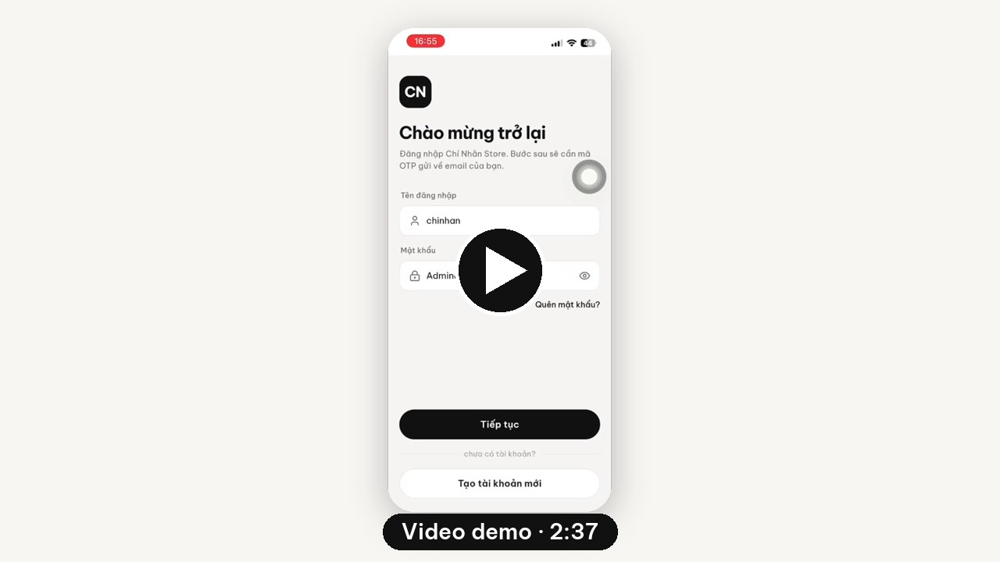

<div align="center">

# Nguyễn Chí Nhân


[**Tải APK**](https://github.com/xT-chinhan/NguyenChiNhan_Project/releases/latest) · [**Bản web (iPhone)**](https://nguyenchinhan-app.vercel.app) · [Web API](https://nguyenchinhan-webapi.vercel.app/swagger) · [Hướng dẫn](HUONG_DAN.md) · [Checklist](CHECKLIST.txt)

<a href="https://github.com/xT-chinhan/NguyenChiNhan_Project/blob/main/docs/demo.mp4"></a>

<sub>Bấm vào ảnh để xem video demo</sub>

   

</div>

## Yêu cầu của thầy

> **Đề 2: App chấm công cho nhân viên** · Nhóm NgọngNL

| # | Yêu cầu | Điểm | Đã làm |
|:-:|---|:-:|---|
| 1 | Đăng ký tài khoản qua email | | ✅ Đăng ký → OTP 6 số gửi email → kích hoạt |
| 2 | Đăng nhập: tên đăng nhập + mật khẩu + OTP | | ✅ 2 bước, OTP email 5 phút, quên mật khẩu |
| 3 | Phân quyền: Admin → quản trị · Nhân viên → Dashboard · Khách hàng → trang tương ứng | | ✅ 3 vai trò, API kiểm tra quyền từng chức năng |
| 4 | Các chức năng CRUD | 5.5 | ✅ Danh mục · Sản phẩm · Người dùng · **Chấm công GPS** |
| 5 | Chọn 3/6 chức năng thuyết trình: **b** Chia sẻ vị trí · **d** Đo tiếng ồn · **f** Dịch realtime, ảnh chụp | 3.5 | ✅ Cả 3 |
| 6 | Tính năng mới các app hiện tại chưa có | 1 | ✅ **Email cảnh báo đăng nhập** · “Không phải tôi” khóa tài khoản, báo Admin |
| 7 | Giao diện đẹp, dễ dùng, cả nhóm chạy được | 1 | ✅ Thiết kế mockup trước · APK + bản web cho iPhone |
| ! | Tên project, WebAPI, CSDL bắt buộc tên cá nhân | | ✅ `NguyenChiNhan_Project` · `NguyenChiNhan_WebAPI` · `nguyenchinhan_db` |

## Tài khoản

| Vai trò | Tên đăng nhập | Mật khẩu |
|---|---|---|
| Quản trị | `chinhan` | `admin123` |
| Nhân viên | `phuc` | `Staff@123` |
| Khách hàng | `baongoc` | `User@123` |

> OTP gửi về `hutech.vn.online@gmail.com`. Muốn tự nhận mã: **Tạo tài khoản mới** bằng email của bạn.

## Cấu trúc

```
NguyenChiNhan_WebAPI/   Web API Node.js · CSDL nguyenchinhan_db
nguyen_chi_nhan_app/    App Flutter (chỉ giao diện, mọi xử lý ở API)
design/                 41 màn mockup + email
docs/demo.mp4           Video demo
```

## Chạy

```bash
# API
cd NguyenChiNhan_WebAPI && npm install && npm run dev   # npm test: 96 bước E2E

# App
cd nguyen_chi_nhan_app && flutter pub get && flutter run
```
