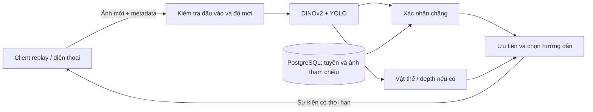

# Kế hoạch core backend dẫn đường NAVI + BlindNav

Đã bổ sung [web mobile thử server](../implementation/mobile-web.md) theo yêu cầu
mới: http://127.0.0.1:8095/mobile. Xem
[receipt bản web](../reports/mobile-web-readiness.json) cho source và kiểm tra mới.

Ngày chốt: 2026-10-21. Trạng thái: **đang thực thi, chưa nghiệm thu backend dẫn đường**.
Thư mục làm việc: `/home/chinhan/projects/blind-navigation-combine`.

Kết quả thực thi cục bộ: [backend-readiness](../reports/backend-readiness.md),
[handoff cho agent](../implementation/agent-handoff.md),
[video public đã tải và chạy thử](../reports/public-video-zaragoza.md).
G0/G1/G2 đã qua trong phạm vi CPU; G3/G4 còn thiếu independent pilot/annotation,
G5 chưa chạy. Không đánh dấu toàn bộ kế hoạch hoàn thành.

## 1. Kết quả cần làm

Xây backend nhận ảnh từ thiết bị, xác nhận người dùng đang ở chặng nào của một tuyến đã khảo sát,
phát hiện vật thể phía trước và trả hướng dẫn ngắn bằng tiếng Việt.
App tương lai chỉ thu camera/cảm biến, truyền dữ liệu, đọc hướng dẫn, rung và xử lý mất kết nối.

Backend phải chạy được bằng client dòng lệnh và video trước khi sửa Flutter.
API khởi động được hoặc test dùng dữ liệu giả chạy qua chưa có nghĩa là AI dẫn đường đúng.

## 2. Đọc các tài liệu theo thứ tự

1. [Nguồn đã kiểm tra, phần tái sử dụng](01-source-audit.md).
2. [Schema dữ liệu, REST và giao thức thiết bị](02-contracts.md).
3. [Thuật toán và quy tắc quyết định](03-core-rules.md).
4. [Công việc T00–T06: nền tảng, dữ liệu, AI](04-tasks-foundation.md).
5. [Công việc T07–T13: điều hướng, stream, replay, vận hành](05-tasks-integration.md).
6. [Dữ liệu nghiệm thu và ma trận kiểm tra](06-validation.md).
7. [Cấu hình, dependency, vận hành và app tương lai](07-operations.md).
8. [Quyết định làm rõ khi thực thi](../implementation/decisions.md) và báo cáo Txx.

Nếu hai đoạn trong plan có vẻ mâu thuẫn:
- `02-contracts.md` quyết định tên trường, đơn vị, HTTP/WS và schema lưu trữ.
- `03-core-rules.md` quyết định trạng thái, thời hạn và thứ tự xử lý.
- `06-validation.md` quyết định bằng chứng đủ để đánh dấu hoàn thành.
- Agent ghi mâu thuẫn và cách sửa vào báo cáo; không tự giảm điều kiện nghiệm thu.

## 3. Những quyết định đã chốt để agent không phải chọn lại

| Chủ đề | Quyết định v1 |
|---|---|
| Phạm vi | Trong nhà, tuyến một chiều được khảo sát và nhập trước |
| Điểm đến | Chọn một tuyến đã publish, có điểm đầu và điểm cuối cụ thể |
| Tìm đường | Chọn tuyến trực tiếp đã lưu; chưa ghép nhiều tuyến bằng graph |
| Thiết bị mặc định | Camera RGB điện thoại Android; client replay thay app trong giai đoạn đầu |
| Depth | Có hợp đồng RGB-D riêng, triển khai thuật toán bằng fixture trước; phần cứng thật là gate riêng |
| Backend | Python 3.12, FastAPI, một tiến trình, module nội bộ rõ ràng |
| Lưu trữ | PostgreSQL 16, SQLAlchemy, Alembic; ảnh tham chiếu JPEG và vector lưu trong DB |
| AI vị trí | DINOv2-base, vector CLS 768 chiều đã chuẩn hóa L2 |
| AI vật thể | YOLO26n ONNX float32, input 224×224, output end-to-end đã kiểm tra |
| GPU | DINOv2 dùng CUDA khi cấu hình rõ; ONNX Runtime CPU cho YOLO v1 |
| Giao tiếp | REST cho dữ liệu và phiên; WebSocket cho yêu cầu chụp ảnh và kết quả |
| Ngôn ngữ | Mã sự kiện cố định + mẫu câu tiếng Việt; không dùng LLM quyết định đi/rẽ/dừng |
| Auth | Admin token từ môi trường; device token ngẫu nhiên, DB chỉ lưu SHA-256 |
| Trạng thái phiên | RAM, tách riêng từng device/session; restart làm mất phiên đang đi, không tự phục hồi |
| App | Chưa sửa NAVI Flutter ở T00–T13; app đọc theo hợp đồng đã kiểm tra sau đó |
| Kiến trúc triển khai | Một backend + một PostgreSQL; chưa Redis, Celery, microservice, Kubernetes |
| Mã gốc | Giữ NAVI/ và BlindNav/ để đối chiếu; backend mới đặt trong backend/ |

Đây là lựa chọn thiết kế để bắt đầu, không phải thiết bị người dùng đã xác nhận.
Nếu sau này chọn RealSense, giữ REST/phiên và bổ sung client RGB-D theo đúng schema đã chốt.

## 4. Phân biệt hai chế độ

**RGB:** biết vật thể xuất hiện ở vùng trái/giữa/phải của ảnh.
Khoảng cách và thời gian tới va chạm phải là `null`; không đổi kích thước bounding box thành mét.
Không nói “đường đã an toàn”, không tự hướng dẫn lách qua vật cản.

**RGB-D:** nhận thêm depth đã căn với ảnh màu và scale mét/pixel từ thiết bị.
Có thể tính khoảng cách, tốc độ khép khoảng cách và cảnh báo theo ngưỡng.
Đây vẫn là nguyên mẫu cần đo và thử trên phần cứng, không phải chứng nhận an toàn.

## 5. Luồng xử lý



Mọi mô hình chạy trên ảnh gốc đã xoay đúng chiều.
Không đưa ảnh đã xóa người bằng inpainting vào nhánh vật cản.
V1 bỏ inpainting khỏi cả đường xử lý trực tiếp để giảm độ trễ và khác biệt ảnh.

## 6. Các mốc hoàn thành độc lập

| Gate | Ý nghĩa | Điều kiện |
|---|---|---|
| G0 | Nền tảng chạy được | Dependency resolve, DB migration, auth và health đúng |
| G1 | Logic core đúng theo đặc tả | Fixture xác định được, trạng thái/ưu tiên/depth/stale/isolation đều qua |
| G2 | AI thật chạy được | Model đúng hash/revision; ảnh thật qua encoder và detector, không dùng fake |
| G3 | Backend dẫn một tuyến mẫu | Video kiểm tra độc lập + ground truth; qua điều kiện ở 06-validation |
| G4 | Đủ để bắt đầu nối app | Replay qua REST/WS thật, xử lý mạng lỗi và restart, báo cáo hiệu năng đầy đủ |
| G5 | Thử có giám sát trên thiết bị | App/camera/calibration/TTS/network được đo; là giai đoạn sau T00–T13 |

Không có video độc lập: ghi `G3 BLOCKED_DATA`; vẫn làm xong code, synthetic test và G2 nếu có model.
Không có camera depth: ghi `RGBD_HARDWARE_NOT_EVALUATED`; không giả kết quả phần cứng.
G4 cần G3; các kiểm tra giao thức của G4 vẫn có thể chạy trước nhưng không đánh dấu gate đã qua.

## 7. Thứ tự công việc

| Task | Sản phẩm chính | Phụ thuộc |
|---|---|---|
| T00 | Package, cấu hình, lockfile, test layout | Không |
| T01 | Types và fixture xác định được | T00 |
| T02 | DB schema, migration, repository | T01 |
| T03 | Auth, device CLI, health, error envelope | T02 |
| T04 | Model fetch/export, manifest và inference thật | T01, T03 |
| T05 | CRUD tối thiểu cho tuyến và publish validator | T02–T04 |
| T06 | Object tracking, depth và obstacle policy | T01, T04 |
| T07 | Localization và route state machine | T01, T05 |
| T08 | Bộ chọn hướng dẫn và mẫu câu Việt | T06, T07 |
| T09 | Phiên REST, WS, freshness và backpressure | T03, T08 |
| T10 | Client replay, import và đánh giá | T05, T09 |
| T11 | Kiểm tra lỗi, rò trạng thái, tải và hợp đồng | T09, T10 |
| T12 | Container, cấu hình và runbook | T11 |
| T13 | Nghiệm thu và bàn giao | T10–T12, dữ liệu thật cho G3/G4 |

Làm tuần tự theo bảng. Không làm UI hoặc tính năng phụ trước khi T09 có kiểm tra qua.
Một task hoàn thành khi có code, kiểm tra đúng hành vi và báo cáo kết quả thật.

## 8. Cấu trúc file đích

```text
backend/
  pyproject.toml                  # entry points, dependency và CPU/CUDA extras
  uv.lock
  src/navcore/
    __init__.py
    app.py                       # create_app(), lifespan; không chứa thuật toán
    settings.py
    logging.py
    api/{auth,errors,health,catalog,sessions,stream}.py
    schemas/{catalog,stream,events}.py
    core/{types,localization,navigation,tracking,depth,obstacles,decisions,messages}.py
    vision/{images,encoder,detector,pipeline,artifacts}.py
    storage/{database,models,catalog,devices}.py
    runtime/{sessions,coordinator,worker}.py
    cli/{__init__,__main__,bootstrap,devices,models,route_import,replay,evaluate,benchmark}.py
  migrations/{env.py,versions/0001_catalog_devices.py}
  tests/
    unit/                        # thuật toán thật, observation xác định được
    integration/                 # PostgreSQL thật + REST/WS
    model/                       # model thật, marker riêng
    fixtures/{synthetic,real/README.md}
  config/{.env.example,compose.yaml,compose.test.yaml,alembic.ini}
  scripts/{check.sh,record_build_inputs.py}
  Dockerfile
  .dockerignore
  .gitignore
  THIRD_PARTY_NOTICES.md
docs/
  plan/                          # bộ tài liệu này
  implementation/{T00.md,...}    # agent tạo khi thực hiện
  reports/                       # JSON/Markdown, không ảnh riêng tư và không token
```

Mỗi file mới dưới 500 dòng. Chỉ tách thêm file khi file hiện tại sắp vượt giới hạn,
ghi đường dẫn mới vào báo cáo task. Không tạo lớp wrapper chỉ chuyển tiếp một hàm.

## 9. Định nghĩa “backend tốt” trong v1

- Sai/thiếu ảnh, model, vị trí hoặc depth phải có trạng thái rõ; không thay bằng giá trị 0 hợp lệ giả.
- Frame hết hạn không được thay đổi chặng, kể cả model vừa trả kết quả xong.
- Một device không đọc hoặc điều khiển được phiên của device khác.
- Không có biến global chứa tracker hoặc tiến độ dùng chung giữa các phiên.
- Model được nạp một lần; ảnh mới không chờ sau một hàng ảnh cũ.
- Bản ghi tuyến đã publish không sửa; phiên đang đi dùng snapshot tuyến lúc bắt đầu.
- Không dùng một frame giống nhau để vượt nhiều chặng.
- Có bằng chứng tách bạch: logic, AI, video thực, hiệu năng, phần cứng.
- Mọi thời hạn/ngưỡng dưới đây là cấu hình nguyên mẫu để kiểm tra, chưa được hiệu chỉnh thực địa.

## 10. Prompt giao cho agent thực hiện

```text
Làm việc tại /home/chinhan/projects/blind-navigation-combine.
Đọc docs/plan/README.md rồi các tài liệu 01–07 theo thứ tự.
Thực hiện T00–T13 trong docs/plan/04-tasks-foundation.md và 05-tasks-integration.md.
Mặc định RGB, indoor, tuyến trực tiếp đã khảo sát; không tự mở rộng phạm vi.
Không sửa code NAVI/ hoặc BlindNav/, không import production script BlindNav.
Chỉ integration owner sửa pyproject/uv.lock/migrations; một writer cho một checkout.
Sau mỗi task: chạy kiểm tra task, ghi docs/implementation/Txx.md với bằng chứng thật.
Thiếu model/video/phần cứng: ghi gate bị thiếu, tiếp tục công việc không phụ thuộc; không fake gate.
Không commit/push/deploy hoặc thay đổi dữ liệu/dịch vụ ngoài dự án khi chưa được yêu cầu.
Đọc 06-validation.md trước khi báo hoàn thành; G1 khác G3 và G4.
```

## 11. Phần chưa nằm trong v1

Ra đường giao thông, qua đường, nhận đèn tín hiệu, hố/bậc thang không được model bảo đảm,
định vị mọi nơi, hướng dẫn né vật cản tự động, bản đồ tự sinh từ một video,
đăng ký tài khoản, mô tả cảnh bằng LLM, TTS cloud, training model và sửa giao diện Flutter.
Chúng cần nhiệm vụ và dữ liệu kiểm tra riêng, không được agent tự thêm vào T00–T13.

